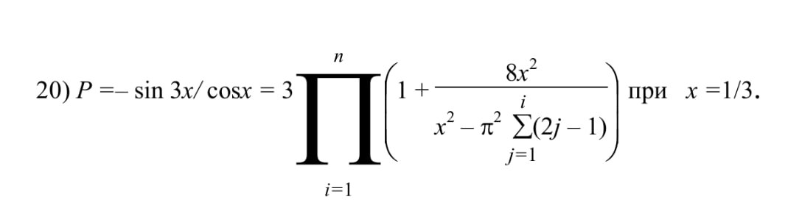
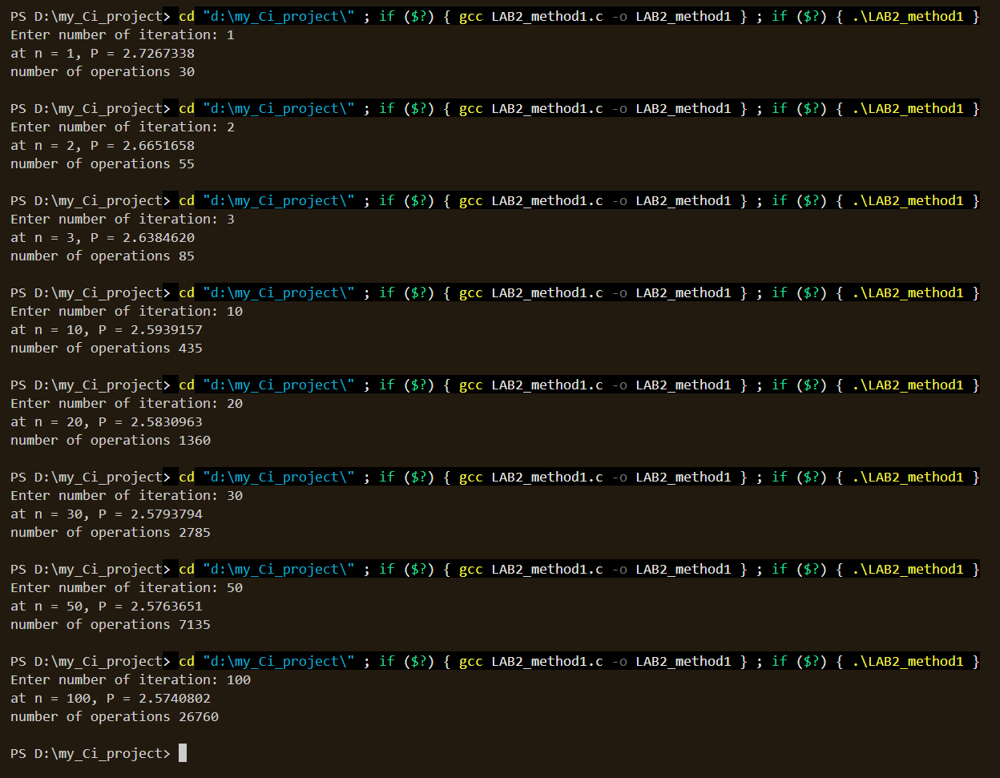
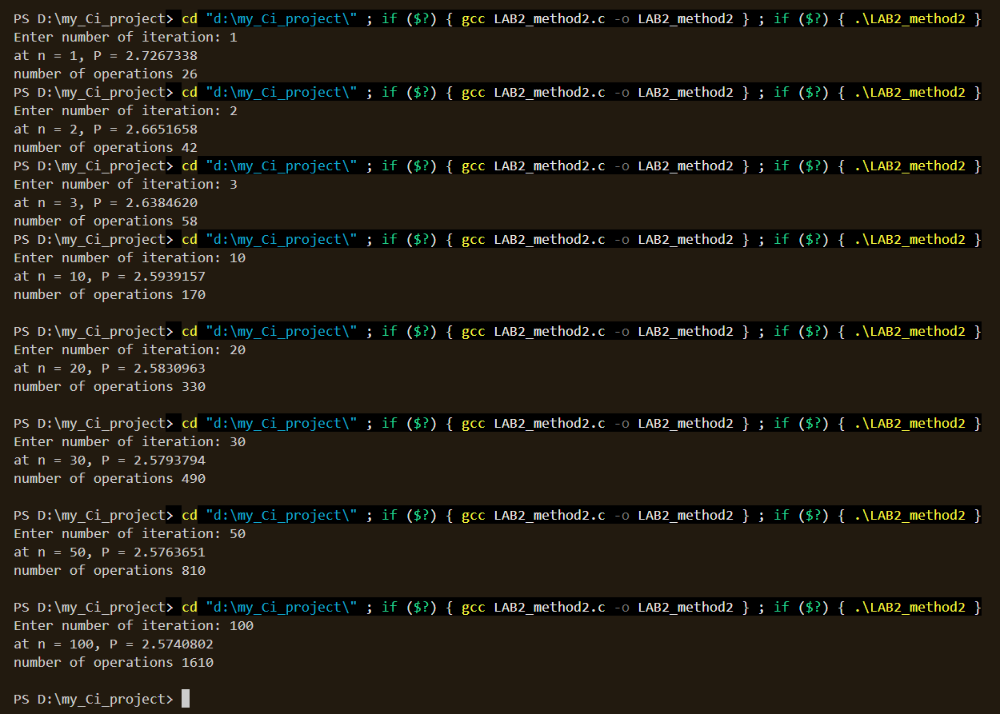

# olshanivskyi_lab2 (Ольшанівський Максим)
SDA second lab
### Національний технічний університет України
### «Київський політехнічний інститут імені Ігоря Сікорського»
### Факультет інформатики та обчислювальної техніки
### Кафедра обчислювальної техніки
---
### Cтруктури даних і алгоритми
### Лабораторна робота №2
### "Алгоритми з вкладеними циклами та метод динамічного програмування"
---
#### Виконав:
#### студент групи ІО-61
#### Ольшанівський М. В.
#### Номер у списку групи: 20
#### Перевірив
#### Русінов В. В.


# Лабораторна робота №2
## Мета лабораторної роботи: 
Засвоєння теоретичного матеріалу та набуття практичних навичок використання різних циклічних керуючих конструкцій, вкладених циклів, методу динамічного програмування та обчислення кількості операцій алгоритмів.
## Постановка задачі:
1. Задане натуральне число n. Обчислити значення заданої за варіантом формули (ряду або добутку, що наближено обчислює значення певної функції у заданій точці; точність наближення залежить від кількості ітерацій n).
2. Для розв'язання задачі написати **дві програми**:
   1. перша програма обчислює формулу за допомогою **вкладених циклів**;
   2. друга програма обчислює ту саму формулу за допомогою **одного циклу** з використанням **методу динамічного програмування** (тобто накопичуючи черговий доданок/множник на основі попереднього, без повторного обчислення статечних, факторіальних і подібних виразів «з нуля» на кожній ітерації).
3. Виконати розрахунок кількості операцій для кожного з алгоритмів за методикою, викладеною на лекції, додавши до неї підрахунок кількості викликів стандартних функцій.
4. Програма має правильно розв'язувати задачу при будь-якому заданому n, для якого результат обчислення коректно представляється типом `double`.
5. Результат виводити у форматі із **сімома знаками після коми**.

## Варіант 20
#### Задане натуральне число n та потрібно обчислити значення формули, де точність наближення залежить від кількості ітерацій n
### 20. P = −sin(3x)/cos x = 3 · Π(i=1..n) {1 + 8x² / [x² − π²·Σ(j=1..i)(2j−1)]} (x = 1/3)

## Програмний код
#### Обрахунок функції за допомогою вкладених циклів (LAB2_method1)
```c
#include <stdio.h>
#include <math.h>

int main()
{
    int n, counter = 0;   
    double S = 0, P = 3;
    counter += 2;

    double x = (1.0 / 3.0);
    counter += 2;

    double pi = acos(-1.0);
    counter += 2;

    double pi_sq = pi * pi;
    counter += 2;

    printf("Enter number of iteration: ");
    scanf("%d", &n);

    counter += 1; // int i = 1
    for (int i = 1; i <= n; i++)
    {
        counter += 1; //i <= n
        counter += 1; // int j = 1
        for (int j = 1; j <= i; j++)
        {
            counter += 1; //j <= i

            S += (2 * j - 1);
            counter += 4;

            counter +2; // j++ та перехід на наступну ітерацію
        }
        counter += 1; // j > i

        P *= 1 + ((8 * x * x) / ((x * x) - (pi_sq * S)));
        counter += 9;

        S = 0;
        counter += 1;

        counter += 2; // i++ та перехід на наступну ітерацію
    }
    counter += 1; // i > n

    printf("at n = %d, P = %.7f\n", n, P);
    printf("number of operations %d\n\n", counter);
    return 0;

}
```
#### Обрахунок функції за допомогою Динамічного програмування (LAB2_method2)
```c
#include <stdio.h>
#include <math.h>

int main()
{
    int n,  counter = 0;
    double S = 0, P = 3;
    counter += 2;

    double x = (1.0 / 3.0);
    counter += 2;

    double pi = acos(-1.0);
    double pi_sq = pi * pi;
    counter += 4;

    printf("Enter number of iteration: ");
    scanf("%d", &n);

    counter += 1; // int i = 1
    for (int i = 1; i <= n; i++)
    {
        counter += 1; //i <= n
        
        S += (2 * i - 1);
        P *= 1 + ((8 * x * x) / ((x * x) - (pi_sq * S)));
        counter += 13;

        counter += 2; // i++ та перехід на наступну ітерацію 
    }
    counter += 1; // i > n

    printf("at n = %d, P = %.7f\n", n, P);
    printf("number of operations %d\n\n", counter);
    return 0;
}
```

## Скріншоти виконна першої програми

## Скріншоти виконна другої програми


## Таблиця резьтатів
### Кількість операцій
| n | 1 | 2 | 3 | 10 | 20 | 30 | 50 | 100 |
|---|---|---|---|---|---|---|---|---|
| Кількість операцій, спосіб 1 (вкладені цикли) | 30 | 55 | 85 |  435 | 1360 | 2785 | 7135 | 26760 |
| Кількість операцій, спосіб 2 (динамічне програмування) | 26 | 42 | 58 | 170 | 330 | 490 | 810 | 1610 |
